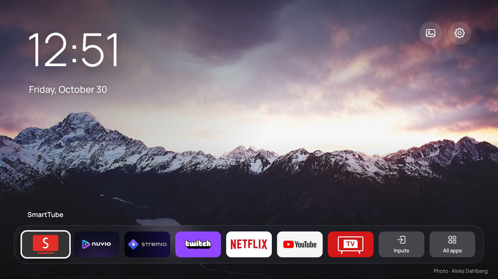
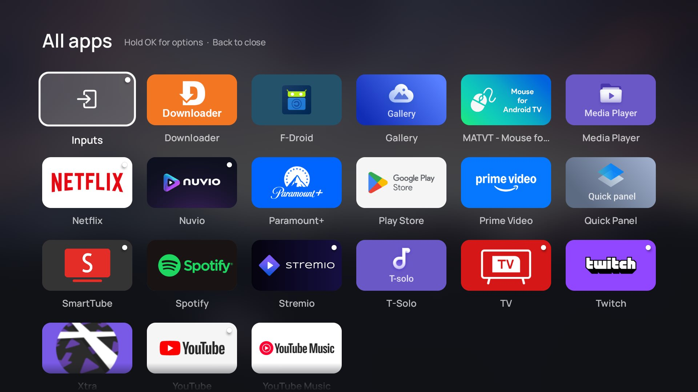
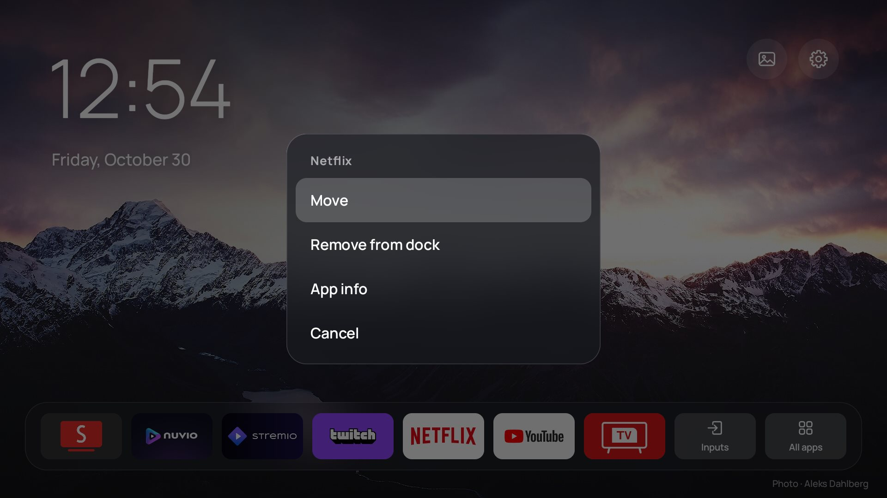
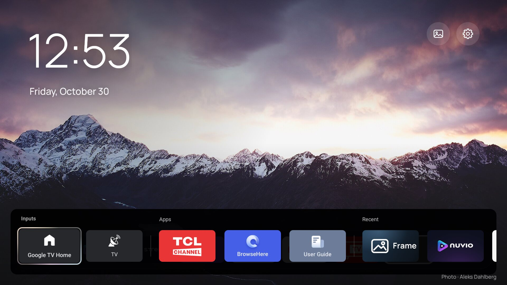

# tcl-tv-despy

Find out what your TCL Google TV is sending home, switch it off, and replace the ad-filled home screen with a fast, clean launcher. **No root. Everything is reversible.**



What this repo gives you:

1. **Findings:** a static (REA/JADX) plus live analysis of every TCL and Google package on the TV: keypress logging, usage and device-ID tracking, a persistent push channel, ad SDKs, dormant ACR and microphone code. Full report: [docs/REPORT-telemetry.md](docs/REPORT-telemetry.md).
2. **Debloat scripts:** disable the telemetry and ad packages for user 0 over ADB, with an automatic backup and a one-command restore.
3. **DNS blocklists:** for NextDNS / AdGuard (Private DNS on the TV), Pi-hole or a router hosts file.
4. **Frame:** a small home-screen app inspired by [CleanFrame](https://github.com/nthnclrk/CleanFrame), with a full-screen photo, a large clock and one row of apps. It requests **no permissions at all**, not even internet. Prebuilt APK on the [Releases](../../releases) page.

> [!WARNING]
> **Use at your own risk.** This project is not affiliated with, endorsed by or supported by TCL, Google or MediaTek. It was tested on one TV model and firmware (below). Package names and behavior may differ on yours, so always start with a dry run. Every change here is a per-user `pm disable-user` / `pm uninstall --user 0` or a setting, and is undone by the restore script or a factory reset. Nothing is deleted from the system partition.

**Tested on:** TCL Smart_TV_Pro (G08_4K_GB), Google TV / Android TV 14 (build UTT2.250416.001), MediaTek MT9653 "merak", 3 GB RAM, region AP, security patch 2025-12-05. Controlled from Windows 11 with Windows PowerShell 5.1.

---

## Contents

- [Findings at a glance](#findings-at-a-glance)
- [0. Prerequisites](#0-prerequisites)
- [1. Connect to the TV over wireless ADB](#1-connect-to-the-tv-over-wireless-adb)
- [2. Investigate with REA (optional)](#2-investigate-with-rea-optional)
- [3. Debloat](#3-debloat)
- [4. Block telemetry at DNS](#4-block-telemetry-at-dns)
- [5. Install Frame and make it the home screen](#5-install-frame-and-make-it-the-home-screen)
- [6. Undo everything](#6-undo-everything)
- [Adapting to other TCL models](#adapting-to-other-tcl-models)
- [Troubleshooting](#troubleshooting)
- [Repository layout](#repository-layout)
- [Credits and license](#credits-and-license)

---

## Findings at a glance

Full details, evidence and hostnames: [docs/REPORT-telemetry.md](docs/REPORT-telemetry.md).

| # | What | Severity |
|---|------|----------|
| 1 | `com.tcl.ttvs` is TCL's telemetry hub. Every TCL app (and even Android Settings) reports through its `BIService`, running as the **system** uid. | 🔴 High |
| 2 | **Remote-control keypresses are logged** (key name, code, time). Which keys get logged is set by TCL's server. | 🔴 High |
| 3 | Usage and viewing stats are uploaded together with device identifiers (Wi-Fi MAC, android_id, serial, IP, ad IDs, DNUM). | 🔴 High |
| 4 | Collection is **on by default** with no user setting: the SDK treats an unset `gdpr_user_action` as "allowed". | 🔴 High, easy fix |
| 5 | A cloud config service posts the device number to `*.api.leiniao.com` (TCL's internet-TV subsidiary). | 🟠 Medium |
| 6 | A persistent push channel to `8.219.1.25:6178` (Alibaba Cloud, Singapore). | 🟠 Medium |
| 7 | Microphone-capture code in the HbbTV engine (`com.tcl.interactive`), dormant on the tested unit. | 🟠 Medium (dormant) |
| 8 | Samba TV **ACR** code and consent screens are present but dormant on the tested region. | 🟡 Low here |
| 9 | Ad SDKs (Smaato, SpotX, smartclip, Google IMA/AdMob, Firebase) in the TCL home feed, TCL Channel and partner rows. | 🟠 Medium |
| 10 | Silent app installs and self-updates (ttvs app store, `tcl_app_autoupdate=1`). | 🟠 Medium |
| 11 | Screen and log capture for "remote diagnosis" (`repairguide`, `logkit`). | 🟡 Low-Med |

After the debloat and DNS blocking, a 3-minute socket watch showed **no connections from TCL system apps at all**. Only Google, YouTube and Chromecast traffic remained.

---

## 0. Prerequisites

All commands below are for Windows (PowerShell). The ADB and REA parts work the same on macOS/Linux; the `.ps1` scripts should run under PowerShell 7 there but are untested.

| Tool | Needed for | Install |
|---|---|---|
| Android platform-tools (`adb`) | Everything | `winget install Google.PlatformTools` |
| Python 3.10+ | `rea_bulk.py` (step 2) | `winget install Python.Python.3.12` |
| Node.js 22.23.4+, 24.22.1+ or 26.12.1+ | REA (step 2) | `winget install OpenJS.NodeJS.LTS` |
| A full JDK 17+ | REA's JADX (step 2) and building Frame | `winget install Microsoft.OpenJDK.21` |
| [REA](https://github.com/morluto/rea) + the JADX MCP jar | Step 2 | See below |
| Android SDK (platform 34, build-tools 34.0.0) | Only if you build Frame yourself | Android Studio's SDK Manager, or the command-line tools |

Open a new terminal after installing so `PATH` is refreshed, then check with `adb version`, `node --version` and `java -version`.

**REA setup** (official sources only: [github.com/morluto/rea](https://github.com/morluto/rea), [rea.tools](https://rea.tools), npm `rea-agents`):

```powershell
npm install -g rea-agents
rea.cmd --version      # in PowerShell use rea.cmd (the rea.ps1 shim is blocked by the default execution policy)

# REA's APK analysis needs jadx-headless-mcp 0.7.1. REA does not download it for you.
$dir = "$env:LOCALAPPDATA\rea"; New-Item -ItemType Directory -Force $dir | Out-Null
$jar = "$dir\jadx-headless-mcp-0.7.1-all.jar"
Invoke-WebRequest https://github.com/1013503897/jadx-headless-mcp/releases/download/v0.7.1/jadx-headless-mcp-0.7.1-all.jar -OutFile $jar
(Get-FileHash $jar -Algorithm SHA256).Hash
# must be 6E5EACF500B64292BFB73C49797C1958F6EE44646E43E868039AE7FEB573FF75
# (the pinned value is in src/android/JadxRelease.ts in the REA repo)
[Environment]::SetEnvironmentVariable('REA_JADX_MCP_JAR', $jar, 'User')   # then open a new terminal
rea.cmd doctor
```

**Running the scripts:** Windows blocks unsigned `.ps1` files by default. Either run each one through `powershell -ExecutionPolicy Bypass -File`, as every example below does, or allow local scripts for your user once with `Set-ExecutionPolicy -Scope CurrentUser RemoteSigned`. Run the commands from the repo root.

---

## 1. Connect to the TV over wireless ADB

1. On the TV, open **Settings → System → About** and press OK on **Android TV OS build** seven times, until it says you're a developer.
2. Go to **Settings → System → Developer options** and turn on **USB debugging** and **Wireless debugging**.
3. Open **Wireless debugging → Pair device with pairing code**. The dialog shows an IP address, a **pairing port** and a 6-digit code. Keep it open.
4. On the PC, pair, then connect. The connect port is the one shown on the main Wireless debugging screen, **not** the pairing port.

   ```powershell
   adb mdns services                          # optional: lists _adb-tls-pairing / _adb-tls-connect ports
   adb pair <TV_IP>:<PAIRING_PORT> <CODE>
   adb connect <TV_IP>:<CONNECT_PORT>
   adb devices                                # should list the TV as "device"
   ```

5. If the TV asks **"Allow wireless debugging on this network?"** or **"Allow USB debugging?"**, tick **Always allow** and accept.

The wireless-debugging port changes after every reboot. On the tested TV, ADB also listened on port **5555** for already-paired PCs, so `adb connect <TV_IP>:5555` gave a stable address. Give the TV a DHCP reservation in your router so its IP doesn't change either.

All scripts find the TV automatically when exactly one ADB device is connected. Otherwise pass `-Serial <TV_IP>:5555`, or set it once per terminal with `$env:TV_SERIAL = '<TV_IP>:5555'`. A `host:port` serial is connected automatically.

---

## 2. Investigate with REA (optional)

You can skip straight to [step 3](#3-debloat) and use the findings in this repo. Do this step if you want to verify them on your own TV, or if your model differs.

```powershell
# 1. Read-only recon: package list, settings, services, a 3-minute connection watch, logcat.
#    Writes recon\<timestamp>\ including suspects.txt (TCL/MediaTek/ads/telemetry packages).
powershell -ExecutionPolicy Bypass -File .\scripts\recon.ps1

# 2. Copy those APKs off the TV (read-only) into apks\<package>\.
powershell -ExecutionPolicy Bypass -File .\scripts\pull-apks.ps1

# 3. Static analysis of every pulled APK with REA (JADX): manifest, permissions, boot hooks,
#    exported services, SDK fingerprints, URLs and hostnames. Writes rea\.
python .\scripts\rea_bulk.py
```

Then read `rea\facts.txt` (per package) and `rea\hosts.txt` (hostname → packages that reference it). To dig into a specific class or method, use REA directly, for example `rea.cmd inspect-android-class` and `rea.cmd inspect-android-method` (see `rea.cmd --help`).

> [!NOTE]
> REA analysis is **static only**. It shows what the code *can* do, not what it does at runtime. That's why `recon.ps1` also captures running services and live connections: always corroborate a finding with what is actually running on the TV.

> [!IMPORTANT]
> `recon\`, `apks\` and `rea\` contain your device's identifiers and TCL's copyrighted code. They're git-ignored, so keep them that way and don't publish them.

`pull-apks.ps1` takes `-Packages a,b` to choose packages; `rea_bulk.py` takes package names, `--workers N` and `--strings-only` (no JADX).

---

## 3. Debloat

The package tiers live in [`scripts/packages.csv`](scripts/packages.csv), along with what each package does and what you lose without it.

**Tier A: telemetry and ads (recommended)**

| Package | What it is | What you lose |
|---|---|---|
| `com.tcl.ttvs` | TCL services hub: BI, usage, keypress and device-ID tracking, push channel, app store and silent installs | TCL T-Cast, TCL's built-in Alexa, TCL message box, TCL app auto-updates, possibly TCL update prompts (re-enable before a firmware update). Google Cast still works. |
| `com.tcl.partnercustomizer` | Injects TCL partner rows into the Google TV home | Partner rows |
| `com.tcl.waterfall.overseas` | TCL content/ads feed with watch history | TCL content feed |
| `com.tcl.channelplus` | TCL Channel (ad-supported FAST channels) | TCL Channel |
| `com.tcl.esticker`, `com.tcl.exhibit` | Store-mode stickers, pop-ups and demo mode | Nothing for home use |
| `com.tcl.magiconnectfree` | TCL phone-to-TV connector (Firebase, AdMob) | TCL phone app link |
| `com.tcl.messagebox` | TCL notifications and promos | Promo notifications |
| `com.tcl.dashboard`, `com.tcl.tv.tclhome_passive` | TCL smart-home dashboard and IoT registration (MQTT, AWS IoT) | TCL smart-home dashboard |
| `com.tcl.logkit`, `com.tcl.repairguide` | Log upload and "remote diagnosis" (screen capture, Bugly) | TCL remote support |
| `com.tcl.interactive` | HbbTV engine (contains microphone-capture code) | HbbTV red-button services (mostly Europe) |
| `tv.mopa.ginga` | Ginga interactive TV (Brazil) | Ginga (Brazil only) |
| `com.tcl.smartalexa`, `com.tcl.eva` | TCL's built-in Alexa; TCL voice/gesture wake-up | Those assistants |
| `com.tcl.usercenter` | TCL account | The TCL account item in Settings |
| `com.tcl.ocean.instructions`, `com.tcl.hotelmenu`, `com.tcl.guard` | E-manual, hotel mode, "Safety Guard" cleaner | Those features |
| `com.google.android.feedback`, `com.android.tv.feedbackconsent` | Google feedback / bug-report upload | Sending feedback to Google |
| `android.autoinstalls.config.google.gtvpai` | Play Auto Installs (pushes partner apps) | Partner app auto-installs |
| `com.google.android.play.games` | Play Games | Play Games |
| `com.android.adservices.api`, `com.android.ondevicepersonalization.services`, `com.android.federatedcompute.services` | Android Privacy Sandbox ad services | Nothing visible. Android may refuse to disable these APEX modules. |

**Tier B: optional features.** These are only removed if you ask for them.

| Package | Feature you lose |
|---|---|
| `com.tcl.useragreement` | TCL consent sync; some TCL apps may re-prompt |
| `com.tcl.initsetup` | TCL first-boot setup, including the Samba TV ACR consent. **Re-enable it before a factory reset.** |
| `com.tcl.UpdatePeripheral` | TCL soundbar firmware updates |
| `com.tcl.hearaid`, `com.tcl.t_solo` | Speaker calibration, listen-alone |
| `com.tcl.gallery` | TCL gallery and its screensaver |
| `com.tcl.gamebar` | HDMI game bar overlay |
| `com.tcl.airplay2`, `com.mediatek.AirplayAPK`, `com.mediatek.airplaydaemon` | AirPlay from iPhone/iPad/Mac |
| `com.tcl.miracast` | Miracast mirroring (Google Cast still works) |
| `com.google.android.katniss` | Google Assistant and the remote's microphone button |
| `com.google.android.apps.tv.dreamx` | Google ambient screensaver |

**Never touched:** Live TV and inputs (`com.tcl.tv`, `com.tcl.tvinput`, `com.tcl.suspension`), remote pairing (`com.tcl.autopair`), SystemUI, Settings, the package installer, the keyboard, Google Play services and the Play Store. `debloat.ps1` refuses to disable these. The stock launcher is only changed by `set-launcher.ps1` in step 5.

**Run it:**

```powershell
# Show the plan without changing anything:
powershell -ExecutionPolicy Bypass -File .\scripts\debloat.ps1 -DryRun

# Tier A (asks you to type YES):
powershell -ExecutionPolicy Bypass -File .\scripts\debloat.ps1

# Tier A plus some Tier B packages (the tested TV ran exactly this):
powershell -ExecutionPolicy Bypass -File .\scripts\debloat.ps1 -Tier A -Include com.google.android.katniss,com.tcl.airplay2,com.mediatek.AirplayAPK,com.mediatek.airplaydaemon,com.tcl.gamebar

# Other options: -Tier A,B   -Exclude <pkgs>   -Tier None -Include <pkgs>   -ListFile my-list.txt   -SkipSettings   -Force
```

What `debloat.ps1` does:
1. Backs up the full package lists, every settings namespace and `getprop` to `backup\<timestamp>\`, and records the prior state of everything it changes.
2. Sets the TCL BI kill switch `settings put global gdpr_user_action 0` and stops TCL's silent app updates with `settings put system tcl_app_autoupdate 0`. Skip this with `-SkipSettings`.
3. Runs `pm disable-user --user 0` on each package. Persistent apps, which Android starts even when disabled, are also removed for user 0 with `pm uninstall -k --user 0`. Packages that aren't installed are skipped.

Reboot the TV afterwards and check that Live TV, your inputs, the remote and your apps still work.

**Also do this by hand on the TV:** Settings → Privacy → **Usage & diagnostics: Off**, and Settings → Privacy → Ads → **Delete advertising ID**.

**Removing other preinstalled apps** (for example streaming apps you don't use): `adb shell pm uninstall --user 0 <package>` hides a preinstalled app for your user; bring it back with `adb shell cmd package install-existing <package>` or from the Play Store. Apps you installed yourself are removed with `adb uninstall <package>`.

---

## 4. Block telemetry at DNS

Disabling packages stops most of the traffic. DNS blocking is the safety net: when ttvs is gone, TCL's SDK can fall back to sending directly from each app.

| File | For |
|---|---|
| [`blocklist/nextdns-denylist.txt`](blocklist/nextdns-denylist.txt) | NextDNS Denylist / AdGuard DNS custom rules (28 domains; each also blocks its subdomains) |
| [`blocklist/tcl-telemetry-ads.txt`](blocklist/tcl-telemetry-ads.txt) | The same list with comments, by category |
| [`blocklist/tcl-telemetry-ads.pihole-regex.txt`](blocklist/tcl-telemetry-ads.pihole-regex.txt) | Pi-hole: Domains → Add regex filter (one per line) |
| [`blocklist/hosts.txt`](blocklist/hosts.txt) | Router or hosts-file format (`0.0.0.0 host`): the base domains plus about 110 subdomains found in the TV's apps |

Deliberately **not** blocked: `tcl.com` (may carry firmware updates) and FreeWheel/Innovid (some streaming apps won't play without them). The push endpoint `8.219.1.25:6178` is an IP address, so DNS can't block it. It disappears once `com.tcl.ttvs` is disabled; if it doesn't, block it in your router's firewall.

### Option A: on the TV only, with Private DNS (NextDNS or any DNS-over-TLS provider)

1. Create a free profile at [nextdns.io](https://nextdns.io). Paste `blocklist/nextdns-denylist.txt` into **Denylist**. Optionally, enable a native tracking-protection list for TCL under **Privacy**.
2. Note the profile's 6-character ID, shown as `<NEXTDNS_ID>.dns.nextdns.io` under **Setup → Android**.
3. Point the TV at it:

   ```powershell
   powershell -ExecutionPolicy Bypass -File .\scripts\set-private-dns.ps1 -ConfigId <NEXTDNS_ID>
   # or any DNS-over-TLS resolver:
   powershell -ExecutionPolicy Bypass -File .\scripts\set-private-dns.ps1 -Hostname dns.adguard-dns.com
   ```

Strict Private DNS fails closed: if the resolver is unreachable, the TV has no internet. The script checks that normal names still resolve and rolls back automatically if they don't. It saves the previous setting to `backup\private_dns_prior.csv`, and `-Off` restores it.

### Option B: Pi-hole / AdGuard Home
Add the regex file, or `tcl-telemetry-ads.txt` as a list, then make the TV use your Pi-hole as its DNS server. You can set that in the router's DHCP settings, or on the TV under Network → your network → IP settings → Static.

> Private DNS on the TV overrides the router's DNS. With a Pi-hole, leave Private DNS off (`set-private-dns.ps1 -Off`).

### Option C: router
Many routers (OpenWrt, Asus Merlin, pfSense/OPNsense, MikroTik) accept a hosts file or domain blocklist. Use `hosts.txt`, or the domain list if your router supports wildcard domains.

---

## 5. Install Frame and make it the home screen

| Home | All apps | Dock menu (hold OK) | Inputs (TCL's panel) |
|---|---|---|---|
|  |  |  |  |

**Frame** is in [`launcher/`](launcher): 8 Java classes, no libraries, no permissions. Cold start takes under a second on the TV.
- Clock and date at the top left. Photo and Settings buttons at the top right.
- One frosted-glass dock row. The focused app's name floats above it.
- **All apps** opens a grid of every TV app, using each app's own banner. A dot marks apps already in the dock. BACK closes it.
- **Inputs** opens TCL's input/source panel (HDMI, TV, and so on).
- **Hold OK** or press **MENU** on any tile for Add to dock, Remove from dock, Move (◀ ▶ then OK) and App info.
- 12 bundled CC0 landscape photos rotate every 10 minutes, or press the photo button. The photographer is credited at the bottom right.

### Install

**Easy way:** download `Frame-<version>.apk` from [Releases](../../releases) and run:

```powershell
adb install -r Frame-1.1.apk
```

**Build it yourself** (JDK 17+ and the Android SDK with platform 34 and build-tools 34.0.0; the Gradle wrapper downloads Gradle 8.7 by itself):

```powershell
cd launcher
$env:ANDROID_HOME = "$env:LOCALAPPDATA\Android\Sdk"     # or create local.properties with sdk.dir=...
.\gradlew.bat assembleRelease
adb install -r app\build\outputs\apk\release\app-release.apk
```

Without a `keystore.properties` file, the release APK is signed with your local Android debug key. To sign it with your own key, copy `launcher/keystore.properties.example` to `keystore.properties` and follow the comments in it. Android only lets you update an app with an APK signed by the same key. If you switch between the release APK and your own build, run `set-launcher.ps1 -Mode stock` first, then `adb uninstall dev.frame.launcher`, then install the new APK.

At this point Frame is installed but **not** the home screen yet. Open it from the app list (or run `adb shell am start -n dev.frame.launcher/.HomeActivity`) and try it out.

### Make it the home screen

Choosing a default launcher is **not enough on Google TV**. The stock launcher (`com.google.android.apps.tv.launcherx`) registers for HOME at priority 2 and its watchdog (`com.google.android.tungsten.setupwraith`) at priority 1. Sideloaded apps are capped at priority 0, and Android ignores your default-home choice while a higher-priority HOME exists. The watchdog also re-enables the stock launcher if you only disable its activity. So the only non-root way is to disable **both** packages for user 0. [The report](docs/REPORT-telemetry.md#taking-over-home-on-google-tv-why-both-launcherx-and-setupwraith-are-disabled) has the details.

```powershell
powershell -ExecutionPolicy Bypass -File .\scripts\set-launcher.ps1 -Mode status
powershell -ExecutionPolicy Bypass -File .\scripts\set-launcher.ps1 -Mode frame    # asks for YES
```

`-Mode frame` checks that Frame starts, disables launcherx and setupwraith, makes Frame the HOME activity, and **rolls back automatically** if HOME doesn't resolve to Frame. Then press HOME, try Inputs and a few apps, and reboot once: the TV should boot straight into Frame.

You lose the Google TV home screen, with its recommendations, ads and "Continue watching" rows. Your apps, the Play Store, Google Cast and voice search (unless you disabled katniss) keep working.

**Back to stock:** `set-launcher.ps1 -Mode stock`.

### Customize

- **Dock:** edit it on the TV (hold OK / MENU). The first-run default (Netflix, YouTube, Prime Video, Disney+, Max, Plex, Spotify, SmartTube, Stremio, Twitch, Live TV, Inputs; apps you don't have are skipped) is `DEFAULT_PINS` in [`Apps.java`](launcher/app/src/main/java/dev/frame/launcher/Apps.java). Uninstalled apps disappear from the dock automatically.
- **Your own photos:** they replace the bundled ones while any are present.

  ```powershell
  powershell -ExecutionPolicy Bypass -File .\scripts\push-photos.ps1 -Path C:\Pictures\TV      # add a folder
  powershell -ExecutionPolicy Bypass -File .\scripts\push-photos.ps1 -Path .\a.jpg,.\b.jpg -Replace
  powershell -ExecutionPolicy Bypass -File .\scripts\push-photos.ps1 -Reset                     # back to bundled
  ```

  Landscape photos of at least 1920×1080 look best.
- **Bundled photos:** replace the files in `launcher/app/src/main/assets/backgrounds/`, update `credits.txt`, and rebuild.

**Remote app buttons:** TCL's YouTube, Prime Video and Google Play buttons are handled by the TV's system, not by the launcher. If the app isn't installed, the button does nothing. Frame swallows generic gamepad `BUTTON_n` keys so they can't open the focused tile by accident.

---

## 6. Undo everything

Run these in this order (each step is independent, so you can undo just one part):

```powershell
powershell -ExecutionPolicy Bypass -File .\scripts\set-launcher.ps1 -Mode stock    # Google TV home back
powershell -ExecutionPolicy Bypass -File .\scripts\restore.ps1                     # re-enable packages + settings (latest backup)
powershell -ExecutionPolicy Bypass -File .\scripts\set-private-dns.ps1 -Off        # Private DNS back to what it was
adb uninstall dev.frame.launcher                                                    # optional; only after -Mode stock!
```

- `restore.ps1 -DryRun` shows what it would do. `-Packages com.tcl.ttvs` re-enables just one package. `-BackupDir backup\<timestamp>` picks a specific backup. Packages removed for user 0 come back with `cmd package install-existing`.
- Without the scripts: `adb shell pm enable <pkg>`, `adb shell cmd package install-existing <pkg>`, `adb shell settings delete global gdpr_user_action`, `adb shell settings put system tcl_app_autoupdate 1`, `adb shell settings put global private_dns_mode opportunistic`.
- **Factory reset** undoes all of it too. Re-enable `com.tcl.initsetup` first if you disabled it.
- **Before a TCL firmware update,** consider running `restore.ps1` (TCL's update prompts may come through ttvs), then re-apply `debloat.ps1` afterwards. Updates can also re-enable packages, so re-run `debloat.ps1 -DryRun` after any update to check.

> [!CAUTION]
> Never uninstall Frame while it's the only home screen (launcherx and setupwraith disabled). Run `set-launcher.ps1 -Mode stock` first.

---

## Adapting to other TCL models

TCL ships many Google TV / Android TV variants. The approach carries over; the package names may not.

1. Run `recon.ps1` and compare `recon\<timestamp>\suspects.txt` and `pkgs_table.txt` with the tables above. `debloat.ps1 -DryRun` marks packages that aren't installed as `SKIP not installed`.
2. Pull and analyze anything new with `pull-apks.ps1 -Packages ...` and `rea_bulk.py`. Look for `com.tcl.bi.*` permissions, boot hooks (`RECEIVE_BOOT_COMPLETED`), `*.leiniao.com` hosts and ad SDKs in `rea\facts.txt`.
3. Add rows to `scripts/packages.csv` (tier A or B), or use `debloat.ps1 -Tier None -Include ...` / `-ListFile`. Never disable anything that handles inputs, the remote, the keyboard or the current HOME.
4. Check which packages provide HOME and at what priority:

   ```powershell
   adb shell cmd package query-activities --brief -a android.intent.action.MAIN -c android.intent.category.HOME
   adb shell dumpsys package com.google.android.apps.tv.launcherx | Select-String -Context 0,3 'android.intent.category.HOME'
   ```

   Older "Android TV" (not Google TV) models use `com.google.android.tvlauncher` and may not have setupwraith. Edit `$stock` and `$stockPkgs` at the top of `set-launcher.ps1` to match.
5. Check the BI switch: `adb shell settings get global gdpr_user_action`. `null` or `1` means TCL telemetry is allowed.
6. Region matters: some regions ship Samba TV ACR active (look for a `sambatv` package or process) or rely on HbbTV (`com.tcl.interactive`).

Pull requests with findings for other models are welcome.

---

## Troubleshooting

| Problem | Fix |
|---|---|
| `adb pair` fails | Use the **pairing** port from the pairing dialog, not the connect port, and keep the dialog open while pairing. |
| `adb connect` refused after a reboot | The wireless-debugging port changes on every reboot. Check it in Developer options (or with `adb mdns services`), or use `<TV_IP>:5555` if your TV listens there. |
| "unauthorized" | Accept the prompt on the TV and tick "Always allow". |
| `... cannot be loaded because running scripts is disabled` | Use `powershell -ExecutionPolicy Bypass -File ...` as shown. |
| `Several adb devices are connected` | Pass `-Serial <TV_IP>:5555`, or `adb disconnect` the others. |
| No internet after `set-private-dns.ps1` | It rolls back automatically, but if needed run `set-private-dns.ps1 -Off` (or Settings → Network → Private DNS → Off). |
| `rea_bulk.py`: `REA_JADX_MCP_JAR is not set` | Do the REA setup in [Prerequisites](#0-prerequisites) and open a new terminal, or use `--strings-only`. |
| Build: `SDK location not found` | Set `ANDROID_HOME`, or create `launcher\local.properties` with `sdk.dir=C:\\path\\to\\Sdk`. |
| `INSTALL_FAILED_UPDATE_INCOMPATIBLE` | The APK is signed with a different key. See the note under [Install](#install). |
| An accessibility service's setup wizard pops up while using `uiautomator` | `uiautomator` makes enabled accessibility services rebind. Close it, and don't use `uiautomator` with Switch Access enabled. |
| "Allow wireless debugging on this network?" at every boot | Tick "Always allow on this network". When you're done, you can turn debugging off in Developer options; turn it back on to run the undo scripts. |

---

## Repository layout

```
blocklist/                 DNS blocklists (NextDNS/AdGuard, Pi-hole regex, hosts)
docs/REPORT-telemetry.md   Full findings, evidence and verification
docs/screenshots/          Frame screenshots
launcher/                  Frame source (Gradle project)
scripts/
  _common.ps1              Shared helpers (TV selection, adb wrapper, protected packages)
  packages.csv             Debloat tiers: package, tier, group, what it does, what you lose
  recon.ps1                Read-only recon (packages, settings, services, connections, logcat)
  pull-apks.ps1            Read-only: copy APKs off the TV for analysis
  rea_bulk.py              Bulk static analysis with REA (JADX) + endpoint extraction
  debloat.ps1              Backup + disable packages + TCL settings
  restore.ps1              Undo debloat.ps1 from a backup
  set-private-dns.ps1      Private DNS (NextDNS / DoT) with automatic rollback
  set-launcher.ps1         Switch HOME between Frame and stock (with rollback)
  push-photos.ps1          Use your own background photos in Frame
```

The scripts write `recon/`, `apks/`, `rea/` and `backup/` next to these folders. All four are git-ignored because they hold device identifiers or vendor code.

---

## Credits and license

- Code (scripts, launcher, blocklists, docs): [MIT](LICENSE).
- Design inspired by [CleanFrame](https://github.com/nthnclrk/CleanFrame) by nthnclrk (a Samsung Tizen home screen). No code was copied.
- Analysis: [REA](https://github.com/morluto/rea) with [jadx-headless-mcp](https://github.com/1013503897/jadx-headless-mcp) / [JADX](https://github.com/skylot/jadx).
- Bundled photos: public domain (CC0), from Wikimedia Commons / Unsplash. Photographers and source links are in [`credits.txt`](launcher/app/src/main/assets/backgrounds/credits.txt).
- Font: [Manrope](https://github.com/sharanda/manrope), SIL Open Font License 1.1 ([`OFL.txt`](launcher/app/src/main/assets/fonts/OFL.txt)).
- TCL, Google, Google TV, Android, Netflix, YouTube and other names are trademarks of their owners. They appear here only to identify packages and apps.
